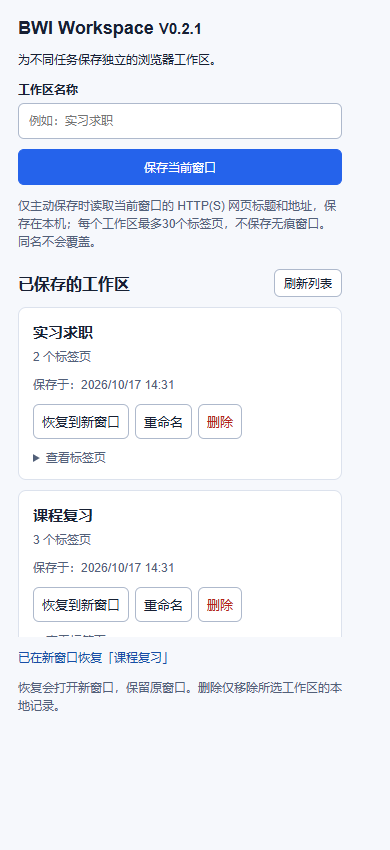

# Browser Workflow Intelligence (BWI)

A Chrome extension for saving and restoring named browser workspaces.

**一个将浏览器标签页整理为多个命名工作区的 Chrome 扩展。**

在“课程学习”“实习求职”等任务之间切换时，可以保存当前窗口的网页组合，随后按原顺序恢复到新窗口。每个工作区独立保存和删除，数据保存在本机。

当前版本：**V0.2.0** · JavaScript · Chrome Manifest V3 · 无构建步骤



## 功能

- 多个命名工作区：名称最多40个字符，空名称和同名保存会被拒绝。
- 保留标签页顺序：仅保存当前窗口的 HTTP(S) 网页，每个工作区最多30个标签页。
- 独立恢复与删除：按工作区名称选择操作，恢复到新窗口并保留原窗口。
- 旧版兼容：自动迁移 V0.1 的 `savedWorkspace`，处理名称冲突和迁移重试。
- 错误反馈：存储读取、写入、标签页查询或窗口创建失败时显示提示；读取失败不会覆盖已有数据。
- 并发保护：多个扩展页面同时保存时，使用 Web Locks 依次执行读取、修改和写入。

## 安装与体验

1. 克隆此仓库，或在 GitHub 选择 **Code → Download ZIP** 后解压。
2. 打开 Chrome 的 `chrome://extensions`，启用“开发者模式”。
3. 点击“加载已解压的扩展程序”，选择仓库中的 **`extension` 文件夹**。
4. 点击工具栏中的 BWI 扩展，输入名称并保存当前窗口。
5. 更换网页后保存为另一个名称，分别恢复，验证两者互不覆盖。

```sh
git clone https://github.com/1851196/browser-workflow-intelligence.git
```

已有 V0.1 的用户可在原目录更新文件后重新加载扩展，保留原扩展身份以迁移已有数据。安装到不同路径可能被 Chrome 视为另一个扩展。

## 实现与学习重点

扩展由三个运行文件组成，不依赖后端服务或前端框架：

```text
extension/
  manifest.json       # 扩展配置、版本和权限
  popup.html          # 输入框、工作区列表和操作界面
  popup.js            # 保存、渲染、恢复、删除、迁移和错误处理
docs/
  learning-notes.md   # 数据结构、函数阅读顺序和手动验收说明
  images/            # 使用测试网页制作的演示截图
tests/
  ui.test.cjs        # 真实 DOM + 模拟 Chrome 接口，覆盖错误及边界场景
  native.test.cjs    # 隔离浏览器配置中加载真实扩展并验证实际接口
```

存储采用工作区对象数组：`{ id, name, savedAt, tabs: [{ title, url }] }`。名称用于显示和重复检查，唯一 `id` 用于定位单项操作。保存用 `push()` 添加记录，恢复用 `find()` 查找，删除用 `filter()` 生成新数组。

旧数据迁移先写入新数组和迁移标记，再删除旧存储键，避免写入失败造成旧记录丢失，也避免重试时重复导入。

详细说明见 [代码导读与手动验收](docs/learning-notes.md)。

## 测试

使用 Node.js 20+。安装扩展本身不需要 Node.js；以下依赖仅用于开发测试。

```sh
npm install
npx playwright install chromium
npm run check
npm test
npm run test:native
```

真实扩展集成测试需要支持 `Extensions.loadUnpacked` 的新版 Chromium，并通过 `--enable-unsafe-extension-debugging` 在独立测试配置中启用扩展调试。测试不连接日常浏览器配置，也不读取真实浏览记录。

也可以使用已安装的 Chrome。例如 Windows PowerShell：

```powershell
$env:BWI_CHROME_PATH = 'C:\Program Files\Google\Chrome\Application\chrome.exe'
npm test
npm run test:native
```

测试结果写入已忽略的 `test-results/`，真实扩展测试的临时配置也保留在此目录。截图使用本机测试网页，不含个人标签页。

V0.2 已完成25项界面及异常场景检查，以及10项真实扩展集成检查，覆盖多工作区互不覆盖、分别恢复、单项删除、顺序保持、旧数据迁移及失败重试。真实集成测试打开扩展自身的 `popup.html` 页面；工具栏弹窗操作另由人工验收。

## 数据与权限

权限为 `tabs` 和 `storage`。仅在主动保存时读取当前窗口的普通网页标题和 URL，并写入 `chrome.storage.local`；不保存无痕窗口。用户可见地删除单个工作区。

没有浏览历史全量读取、网页按键或表单记录、自动上传，也不调用远程 AI 服务。网页 URL 可能包含查询参数，保存前可自行检查当前窗口。

## 当前边界

仅保存网页标题与 URL，不恢复登录状态、表单内容、标签分组或滚动位置；同名不覆盖；删除尚无撤销。只校验 URL 格式和 HTTP(S) 协议，不探测网站是否在线。

后续计划：工作区重命名、删除确认、JSON 导入与导出。版本变化见 [CHANGELOG](CHANGELOG.md)。
